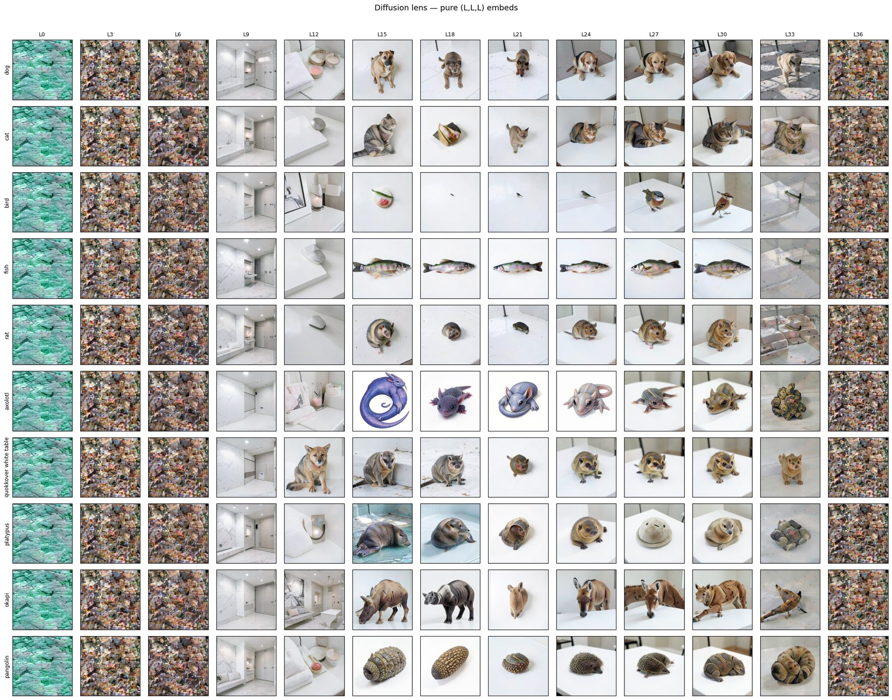
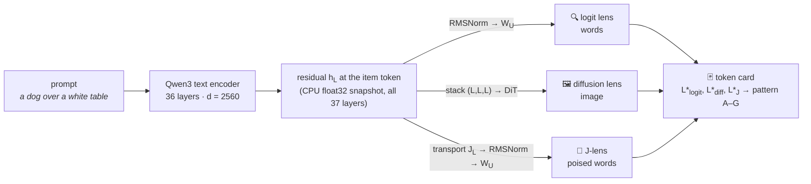
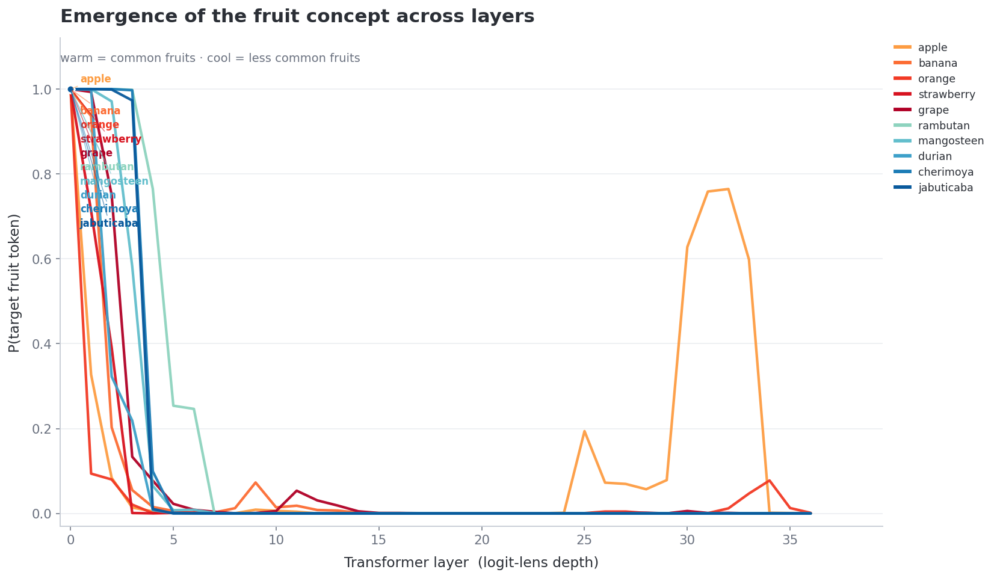
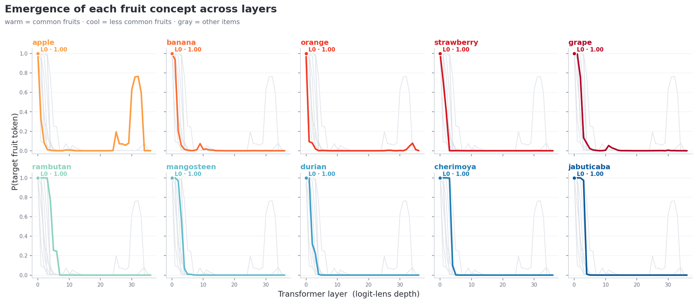
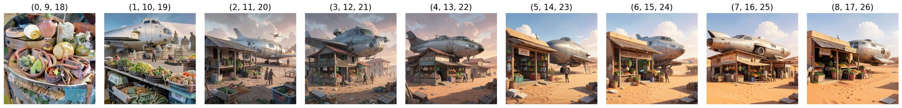
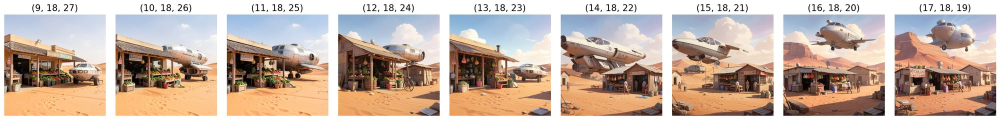

<h1 align="center">mech-interp-lenses</h1>

<p align="center">
  <b>Where does a concept become a word, and where does it become a picture?</b><br>
  Logit, diffusion and Jacobian lenses on the Qwen3 text encoder inside <a href="https://huggingface.co/black-forest-labs/FLUX.2-klein-4B">FLUX.2 Klein 4B</a>.
</p>

<p align="center">
  
  
  
  
  
</p>

<p align="center">
  
</p>
<p align="center"><sub>
<b>Diffusion lens.</b> Each cell is FLUX.2 Klein rendering <code>"a {animal} over a white table"</code> from <em>one</em> text-encoder layer <code>L</code> (pure <code>(L,L,L)</code> prompt embeds, seed 42, 4 steps). Rows: easy animals (own BPE token) on top, rare multi-token animals below. The scene arrives before the subject (L9–12), the subject arrives at L15, and rare animals get rendered as their nearest <em>category</em> rather than their identity. (The <code>quokka</code> row label carries an old prompt-parsing bug, since fixed in <code>lenses.tokens.parse_item</code>.)
</sub></p>

---

## What this is

A text-to-image model like FLUX.2 Klein never sees your prompt — it sees a stack of hidden states from a 36-layer Qwen3 language model. This repo asks, layer by layer, **what that language model knows about the prompt and when**, using three read-outs of the *same* cached residual stream:

| Lens | Question it answers | Output | Script |
|---|---|---|---|
| 🔍 **Logit lens** | *If I decode this layer's residual as if it were the last one, which word comes out?* | top-k tokens · P(target) vs. layer · L*<sub>logit</sub> | `run_logit_lens.py`, `run_emergence_curve.py` |
| 🖼️ **Diffusion lens** | *If I hand this layer to the image model, what picture do I get?* | image grid · L*<sub>diff</sub> | `run_diffusion_lens.py` |
| 🧲 **J-lens** | *Which words is this activation* poised *to produce, after transporting it into the final-layer basis?* | top-k "silent" words · rank curves · L*<sub>J</sub> | `run_j_lens.py` |
| 🃏 **Token cards** | *Do the three depths (L\*<sub>logit</sub>, L\*<sub>J</sub>, L\*<sub>diff</sub>) form a repeating pattern across items?* | pattern A–G per item | `run_token_cards.py` |

The unit of comparison is an **easy vs. hard** prompt family: five common items that have their own token (`dog`, `apple`) against five rare ones the tokenizer shatters (`axolotl` → `ax ol ot l`, `jabuticaba` → `j ab utic aba`).



---

## Results so far

> Preliminary: ten prompts per family, one seed, 4 sampling steps. Numbers are for orientation, not claims.

### 1 · The image model gets the scene before the subject, and category before identity

In the grid above the text encoder's **embedding and first ~6 layers carry no usable conditioning** (texture noise). By **L9–L12 the white table and room are there with nothing on them**. The subject appears at **L15** — immediately correct for `dog`, `cat`, `fish`, `rat`, while the rare animals are rendered as a neighbour from the same family: `axolotl` → a salamander-like creature, `platypus` → a seal, `okapi` → rhino → tapir → a striped donkey, `pangolin` → an armadillo. Between L15 and L30 the easy animals sharpen; the hard ones drift between neighbours without ever locking. The last index (post-final-norm state) collapses back to noise.

### 2 · Token identity is erased within five layers, then (sometimes) re-assembled late

<p align="center"></p>

Logit lens at the item position, fruit family, reading P(input token) per layer (`run_emergence_curve.py --own-token-only`). Every curve starts at 1.0 (layer 0 is the embedding) and **falls to ~0 by layer 3–7** — the residual stops being "about the token string". Only `apple` is re-assembled as a word late, peaking at **≈ 0.76 around L31–32**; the rest of the stream is spent on something that is not the literal word. Rare fruits read at their last sub-piece (`utan`, `aba`) decay the same way, a little later.

<p align="center"></p>

### 3 · Which three layers FLUX stacks matters — a lot

FLUX.2 Klein builds its prompt embedding by stacking **three** encoder hidden states. Sweeping evenly-spaced triples `(i, i+9, i+18)` (top) and squeezing a palindrome `(18−k, 18, 18+k)` toward the centre (bottom) on `"A spaceship parked near a vegetable shop in desert"`:

<p align="center">
  <br>
  
</p>

The earliest stack `(0, 9, 18)` renders produce with no spaceship at all; from `(1, 10, 19)` on, both objects are composed. In the palindrome sweep the spaceship's presence and placement change non-monotonically as the stack narrows — parked beside the shop, nearly absent at `(12, 18, 24)`–`(13, 18, 23)`, then airborne above it at `(16, 18, 20)`–`(17, 18, 19)`. Composition is distributed across depths, not stored in one.

### Where this points

The animals grid suggests a **pattern-D** story for rare tokens — *the encoder forms a category feature but never an identity feature, and the DiT faithfully renders the category* — and a **pattern-A** story for easy ones — the word is decodable long before the image is clean. `run_token_cards.py` is the harness for turning that hunch into counts; `docs/three_lenses.md` lists the first causal experiment for each pattern (e.g. patch the layer-L* `dog` residual into an `axolotl` prompt and watch the image).

---

## Quickstart

```bash
git clone https://github.com/vishwalization/mech-interp-lenses
cd mech-interp-lenses
pip install -e .                     # or: pip install -r requirements.txt
export HF_TOKEN=hf_...               # FLUX.2 Klein is gated
```

One GPU with ≥ 16 GB is enough: the pipeline runs with `enable_sequential_cpu_offload()`. All lens maths happens on CPU in float32 afterwards.

```bash
# 🔍 top-k per layer at the item token, with vs. without FLUX's chat template
python scripts/run_logit_lens.py      --config configs/animals.yaml --prompt-idx 0

# 📈 P(target) per layer for every item → curves, top-1 table, L*_logit
python scripts/run_emergence_curve.py --config configs/fruits.yaml

# 🖼️ one image per (prompt, depth), stride 3 → 130 images + grid  (resumable: existing files are skipped)
python scripts/run_diffusion_lens.py  --config configs/animals.yaml --stride 3

# 🧲 DIY diagonal-transport J-lens vs. raw logit lens → L*_J   (add --official for Anthropic's jlens)
python scripts/run_j_lens.py          --config configs/animals.yaml --print-idx 0 5

# 🃏 fuse the three L* per item and classify patterns A–G       (CPU only)
python scripts/run_token_cards.py     --config configs/animals.yaml --manual configs/lstar_human_animals.yaml

# 🧪 layer-combination ablation of the (i, i+9, i+18) stack on long scene prompts
python scripts/run_layer_ablation.py  --config configs/scenes.yaml --mode palindrome
```

Every script writes to `results/<lens>/<config-name>/` and prints a cache **fingerprint** before and after the pass; if the two differ, something is mutating your activations (see *Engineering notes*).

### Use it as a library

```python
from lenses.model import load_pipeline
from lenses.activations import capture_hidden_states
from lenses.unembed import Unembed
from lenses.logit_lens import logit_lens
from lenses.tokens import find_item_position

lp = load_pipeline()                                     # FLUX.2 Klein, offloaded
hs = capture_hidden_states(lp.text_encoder, lp.tokenizer, ["a dog over a white table"], device=lp.device)
unembed = Unembed.from_text_encoder(lp.text_encoder, lp.tokenizer)

pos = find_item_position(lp.tokenizer, hs.input_ids[0], "dog")   # → 4 under the chat template
for L, top in logit_lens(hs, unembed, b=0, pos=pos, topk=3).items():
    print(L, top)
```

```python
from lenses.diffusion_lens import make_prompt_embeds, generate
img = generate(lp.pipe, make_prompt_embeds(hs, (15, 15, 15), batch_index=0), seed=42)
```

---

## Repository layout

```
mech-interp-lenses/
├── src/lenses/                  importable package (pip install -e .)
│   ├── model.py                 load Flux2KleinPipeline with offload + HF login
│   ├── activations.py           capture_hidden_states → CPU fp32 HiddenStates · fingerprint
│   ├── unembed.py               materialize_weight (meta-safe) · functional rms_norm · Unembed
│   ├── tokens.py                parse_item · find_item_position · target_vocab_ids · resolve_targets
│   ├── logit_lens.py            logit_lens · emergence_curve · rank_curve · first_emergence_layer · top1_table
│   ├── diffusion_lens.py        make_prompt_embeds · generate · depth/triple selectors · run_pure_lens · CLIP proxy
│   ├── j_lens.py                DiagonalTransport (DIY) · j_lens · fit_official_jlens (Anthropic)
│   ├── token_cards.py           Thresholds · classify (A–G) · build_cards · leading_pattern
│   ├── plotting.py              emergence curves · small multiples · image grids/strips · scatter
│   └── config.py                YAML → ExperimentConfig
├── scripts/                     one CLI per lens (run_*.py) + experiment scaffolder
├── configs/                     prompt families: animals.yaml · fruits.yaml · scenes.yaml · lstar_human_*.yaml
├── tests/                       CPU-only unit tests (pytest) — no model download
├── docs/
│   ├── three_lenses.md          method overview, run order, pattern cheat-sheet
│   ├── notes/offload-safe-activations.md   the bug that shaped activations.py / unembed.py
│   └── experiment_loop.md       push-to-run GPU loop (self-hosted runner on RunPod)
├── experiments/                 one folder per GPU run; pushing one triggers the workflow
├── assets/                      curated figures used in this README
└── results/                     gitignored — generated images, JSON, logs
```

### Adding a prompt family

Drop a YAML in `configs/`. Items are parsed from `"a/an {item} over …"` prompts automatically (or list `items:` explicitly, as `scenes.yaml` does). `fallback_word` is the category token used for items that have no token of their own, so their curve measures *category* emergence.

```yaml
name: vehicles
concept_label: vehicle
fallback_word: vehicle
easy_count: 3
prompts:
  - "a car over a white table"
  - "a bus over a white table"
  - "a bicycle over a white table"
  - "a trebuchet over a white table"
  - "a velocipede over a white table"
  - "a zeppelin over a white table"
```

---

## Engineering notes

Three things that are easy to get wrong with this model, each baked into the package so you don't have to remember them:

1. **Activations must be snapshotted to CPU float32 immediately.** Under `enable_sequential_cpu_offload()`, hidden states left on the GPU are overwritten by later kernels — first run partially garbage, second run entirely garbage, "fixed" by re-running the forward. `capture_hidden_states` does `detach().float().cpu().contiguous().clone()` on every layer. Full write-up: [`docs/notes/offload-safe-activations.md`](docs/notes/offload-safe-activations.md).
2. **Never read `.weight` on an offloaded module.** It is a `meta` tensor; `.cpu()` raises *"Cannot copy out of meta tensor"*. `materialize_weight` goes through `accelerate.utils.align_module_device`. The final norm is then applied as a pure function, never via the live `nn.Module`.
3. **The last hidden state is already post-final-norm.** HF's `Qwen*Model.forward` appends `self.norm(h)` after the block loop, so every lens applies RMSNorm to layers `0 … n-2` only.

Also: `output_hidden_states=True` returns *all* layers for the *whole batch* in one pass, so the diffusion lens captures once and re-slices — $N\times$ cheaper than calling `_get_qwen3_prompt_embeds` per layer combination. And the DIY J-lens is a per-dimension least-squares scale $h_{\text{final}} \approx h_L \odot s_L$, not a Jacobian; use `--official` (anthropics/jacobian-lens, fitted on a separate non-offloaded copy of the encoder) before making lens-dependent claims.

---

## Token-card patterns

| Code | Name | Rule of thumb | What it would mean |
|:---:|---|---|---|
| **A** | early verbal, late visual | logit & J early; diff ≥ 8 layers later | the word locks before FLUX can use it |
| **B** | visual before verbal | diff early; logit/J late | the picture locks before the name is decodable |
| **C** | easy triad | all three early, easy bucket | control |
| **D** | hard triad | all late / missing, hard bucket | category without identity (rare tokens) |
| **E** | J-only intermediate | manual — multi-hop prompts | silent intermediate concept |
| **F** | chat-template shift | manual — with vs. without template | the template changes the workspace |
| **G** | logit ≠ J | \|L\*<sub>logit</sub> − L\*<sub>J</sub>\| ≥ 8 | raw logit lens misleads; trust transport |

Thresholds live in `lenses.token_cards.Thresholds` and as CLI flags on `run_token_cards.py`. A `None` L\* means *the lens ran and the target never emerged* (counted as late); lenses that were not run are tracked in a `measured` column and a card with fewer than two is `?`. A pattern that repeats ≥ 3 times is the research path; `RESEARCH_PATHS` lists the first causal experiment for each.

---

## Push-to-run GPU loop

`experiments/` + `.github/workflows/run-experiment.yml` implement a *describe → push → the GPU runs it* loop on a self-hosted GitHub runner (RunPod). Copy `experiments/_template/`, set `method:` in its `config.yaml`, push to `main`; results land in `/workspace/results/<exp>/`. Setup guide: [`docs/experiment_loop.md`](docs/experiment_loop.md).

---

## Roadmap

- [ ] Fit the official Jacobian lens on the Qwen3 encoder weights and compare against the diagonal transport (pattern **G** rate)
- [ ] Fill `L*_diff` for the animals and fruits families with a CLIP proxy (`--clip`) and compare to the human reading
- [ ] Pattern **F**: run every lens with and without the chat template on the same prompts
- [ ] Causal test for pattern **A**/**D**: activation-patch the easy item's layer-L* residual into a hard prompt and score the image
- [ ] Scale to ≥ 30 items per family so pattern counts are meaningful; add a third family (objects / vehicles)

---

## References

- nostalgebraist. *interpreting GPT: the logit lens.* LessWrong, 2020.
- Toker, Orgad, Ventura, Arad, Belinkov. *Diffusion Lens: Interpreting Text Encoders in Text-to-Image Pipelines.* ACL 2024.
- Kaplan, Toker, Reif, Belinkov, Schwartz. *Follow the Flow: On Information Flow Across Textual Tokens in Text-to-Image Models.* 2025.
- Toker, Galil, Orgad, Gal, Tewel, Chechik, Belinkov. *Padding Tone: A Mechanistic Analysis of Padding Tokens in T2I Models.* 2025.
- Anthropic. *Jacobian lens* — [anthropics/jacobian-lens](https://github.com/anthropics/jacobian-lens).
- Black Forest Labs. *FLUX.2 Klein 4B* — [black-forest-labs/FLUX.2-klein-4B](https://huggingface.co/black-forest-labs/FLUX.2-klein-4B).

## Citation

```bibtex
@software{vishwanathan2026mechinterplenses,
  author = {Vishwanathan, A.K.},
  title  = {mech-interp-lenses: logit, diffusion and Jacobian lenses on the FLUX.2 Klein text encoder},
  year   = {2026},
  url    = {https://github.com/vishwalization/mech-interp-lenses}
}
```

## License

[MIT](LICENSE) — model weights are subject to their own licenses.
